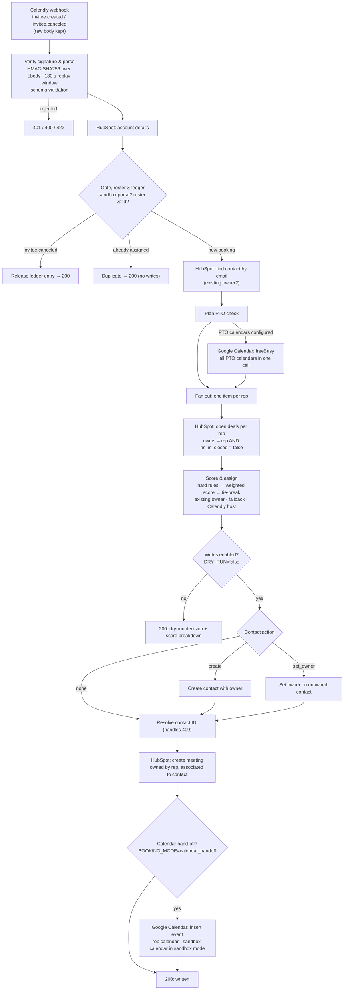

# n8n-calendly-smart-workload-balancer

A webhook-driven scheduling balancer for **n8n** and **Node.js**. It intercepts Calendly `invitee.created` webhooks and decides which sales rep should own each meeting. A **true weighted round robin** is corrected in real time for:

- **PTO**, read live from each rep's PTO calendar through Google Calendar free/busy.
- **Active deal load**, counted from open HubSpot deals per owner.
- **Working hours and timezone fit**, comparing the invitee's timezone with each rep's region and local business hours.

It then writes the decision to HubSpot: the contact owner and a meeting record owned by the assigned rep. It can also place a hand-off event on the rep's calendar.

I built it fail-safe. With the blank `.env.example`:

- **`DRY_RUN`, `SANDBOX_MODE`, and `REQUIRE_SIGNATURE` are all on.** Unsigned webhooks are rejected.
- HubSpot is used only after the portal is verified as a sandbox.
- Nothing is written. Each request returns the full decision with a score breakdown.

The repository contains **no real keys, secrets, calendar IDs, or client data**. Every identifier is a dummy (`REP_ID_01`, `USER_ID_01`, `mock_token_here`), every domain is RFC 2606 (`example.com`), and `workflow.json` ships with no credential references.

---

## Contents

- [Why I built it](#why-i-built-it)
- [Architecture](#architecture)
- [Workflow nodes](#workflow-nodes)
- [Webhook payload schema](#webhook-payload-schema)
- [Logic breakdown](#logic-breakdown)
- [Rep roster schema](#rep-roster-schema)
- [Repository layout](#repository-layout)
- [Environment variables](#environment-variables)
- [Deployment steps](#deployment-steps)
- [Safety gates and modes](#safety-gates-and-modes)
- [Edge-case handling](#edge-case-handling)
- [Testing and validation](#testing-and-validation)
- [Disclaimer & Liability Limitation](#️-disclaimer--liability-limitation)
- [License](#license)
- [Author](#author)

---

## Why I built it

Calendly's round robin rotates bookings by availability and priority, but it can't see the CRM. It doesn't know that one rep already carries 38 open deals while another has 20, that a rep is on PTO tracked in a separate calendar, or that a buyer in Chicago would be better served by an Americas rep than by one on the other side of the world. Over a quarter, "round robin" quietly becomes "whoever has the emptiest calendar", and workloads drift.

This balancer keeps its own **fairness ledger** and treats each booking as a routing decision:

1. **Hard rules** remove reps who are inactive, on PTO, at deal capacity, or outside working hours.
2. **Soft rules** score the rest on fairness deficit, deal-load headroom, and timezone fit.
3. **Existing relationships win.** If HubSpot already shows an available owner for the contact, the meeting goes to them, and an existing owner is never overwritten.

---

## Architecture



The same logic runs in two places:

| Runtime | Entry point | Use it for |
| --- | --- | --- |
| n8n | `workflow.json` | Production webhook handling inside n8n |
| Node.js | `src/index.js --serve` | Local testing, offline dry runs, or a small standalone service |

There is one source of truth. The config gates and the balancer live in `src/` inside `// <n8n-core:…>` markers, and `scripts/build-workflow.js` embeds those exact regions into the n8n Code nodes. The tests run the n8n Code nodes in a sandbox and prove they produce **the same decision and the same CRM actions** as the Node engine. `scripts/validate-workflow.js` fails CI if a write node can be reached without its gate.

---

## Workflow nodes

| # | Node | Type | Purpose |
| --- | --- | --- | --- |
| 1 | Calendly Webhook | Webhook (raw body on) | Receives `invitee.created` and `invitee.canceled` |
| 2 | Verify Signature & Parse | Code | Loads config, verifies `Calendly-Webhook-Signature`, validates the payload |
| 3 | Accepted? | IF | Rejects bad signatures and payloads (401 / 400 / 422) |
| 4 | HubSpot: Account Details | HTTP | Portal type for the sandbox gate |
| 5 | Gate, Roster & Ledger | Code | Enforces the gate, loads the roster, prunes the ledger, handles cancellations and duplicates |
| 6 | Needs Assignment? | IF | Only new bookings continue |
| 7 | HubSpot: Find Contact by Email | HTTP | Existing contact and owner |
| 8 | Plan PTO Check | Code | Builds one freeBusy request for all PTO calendars |
| 9 | Check PTO Calendars? → Google Calendar: PTO FreeBusy | IF → HTTP | Live PTO lookup |
| 10 | Fan Out Reps | Code | One item per rep, with the open-deal search |
| 11 | HubSpot: Open Deals per Rep | HTTP (batched) | Active deal load |
| 12 | Score & Assign | Code | Eligibility, scoring, decision, CRM actions, ledger update |
| 13 | Writes Enabled? | IF | Dry-run decisions stop here |
| 14 | Route Contact Action | Switch | `create`, `set_owner`, or `none` |
| 15 | HubSpot: Create Contact (with Owner) / Set Contact Owner | HTTP | Ownership |
| 16 | Resolve Contact ID | Code | Created ID, 409 conflict ID, or the existing ID |
| 17 | Create HubSpot Meeting? → HubSpot: Create Meeting | IF → HTTP | Meeting owned by the rep, associated to the contact |
| 18 | Calendar Hand-off? → Google Calendar: Insert Hand-off Event | IF → HTTP | Optional event on the rep's (or sandbox) calendar |
| 19 | Respond: … | Respond to Webhook | Rejected, released/duplicate, dry-run decision, or written |

---

## Webhook payload schema

The balancer reads these fields from a Calendly webhook (v2 shape). Everything else is ignored. The full mocked payloads are in `test/fixtures/calendly-webhook.mock.json`.

```json
{
  "event": "invitee.created",
  "created_at": "2026-11-16T13:54:30.000000Z",
  "payload": {
    "uri": "https://api.calendly.example.com/scheduled_events/EVENT_ID/invitees/INVITEE_ID_101",
    "email": "new.buyer@example.org",
    "name": "Jordan Buyer",
    "timezone": "America/Chicago",
    "rescheduled": false,
    "scheduled_event": {
      "uri": "https://api.calendly.example.com/scheduled_events/EVENT_ID_101",
      "name": "Discovery Call",
      "start_time": "2026-11-17T17:00:00.000000Z",
      "end_time": "2026-11-17T17:30:00.000000Z",
      "event_type": "https://api.calendly.example.com/event_types/EVENT_TYPE_ID_01",
      "location": { "type": "zoom", "join_url": "https://meet.example.com/mock-room-101" },
      "event_memberships": [{ "user": "https://api.calendly.example.com/users/USER_ID_01", "user_email": "intake@example.com" }]
    }
  }
}
```

| Field | Use | Required |
| --- | --- | --- |
| `event` | `invitee.created` routes; `invitee.canceled` releases the ledger entry | yes |
| `payload.uri` | Idempotency key (one assignment per invitee) | yes |
| `payload.email` | Contact lookup and creation | yes |
| `payload.name` | Contact first and last name, meeting title | no |
| `payload.timezone` | Invitee region and offset (falls back to `TIMEZONE_DEFAULT`) | no |
| `scheduled_event.start_time` / `end_time` | PTO overlap, working hours, meeting record | yes |
| `scheduled_event.name` | Meeting title | no |
| `scheduled_event.location.join_url` | Meeting link (`https://` only) | no |
| `scheduled_event.event_memberships[].user_email` | Calendly host(s), for the host-match check and fallback | no |

**Signature.** Calendly sends `Calendly-Webhook-Signature: t=<unix seconds>,v1=<hex>`, where `v1 = HMAC-SHA256(signing_key, "<t>.<raw body>")`. I verify it over the **raw** request body, compare in constant time, and reject anything older than `SIGNATURE_TOLERANCE_SECONDS` (default 180) to block replays.

---

## Logic breakdown

**1. Existing owner first.** If the invitee is already a HubSpot contact whose owner is a rostered rep who passes every hard rule, the meeting goes to that owner (`existing_owner`). If that owner is excluded, for example on PTO, the meeting is round-robined, the contact's owner is left unchanged, and a warning names the reason.

**2. Hard rules (exclusion).**

| Rule | Source | Reason code |
| --- | --- | --- |
| Rep inactive | roster `active: false` | `inactive` |
| PTO overlaps the meeting | Google Calendar freeBusy on `ptoCalendarId` | `on_pto` |
| Open deals ≥ `maxActiveDeals` | HubSpot deal search | `at_deal_capacity` |
| Meeting outside local working hours | roster `workingHours` in the rep's timezone | `outside_working_hours` (penalty instead when `STRICT_WORKING_HOURS=false`) |

**3. Soft rules (score).** For each eligible rep:

```text
fairness    = clamp((targetShare − actualShare) / targetShare, −1, 1)
                targetShare = weight / Σ weights of eligible reps
                actualShare = recent assignments / Σ recent assignments (eligible reps, last ASSIGNMENT_WINDOW_DAYS)
loadFit     = 1 − min(1, openDeals / maxActiveDeals)              (0.5 when the deal count is unknown)
timezoneFit = 1 if the invitee's region is in the rep's regions,
              else 1 − min(offset gap, 12) / 12                   (offset gap in hours, DST-aware)

score = WEIGHT_FAIRNESS × fairness + WEIGHT_LOAD × loadFit + WEIGHT_TIMEZONE × timezoneFit − workingHoursPenalty
```

**4. Tie-break.** Highest score wins, then the rep assigned **least recently**, then rep ID. The result is fully deterministic.

**5. Fallbacks.** If no rep is eligible: `FALLBACK_REP_ID` (`fallback`), then a rostered Calendly host (`kept_calendly_host`), then `unassigned`. An unassigned decision writes nothing.

**6. Ledger.** Every assignment is recorded by invitee URI **before** the CRM writes, so a retried webhook is answered as `duplicate` and never re-assigned. `invitee.canceled` removes the entry, so a cancelled meeting stops counting toward the rep's share. Over time each rep's share converges to their weight. The tests simulate 120 bookings across reps weighted 1 : 2 : 3 and confirm a 20 / 40 / 60 split, each within one booking.

**Worked example** (the fixture scenario, meeting Tue 17:00–17:30 UTC, invitee in America/Chicago):

| Rep | Status | Fairness | Load fit | Timezone fit | Score |
| --- | --- | --- | --- | --- | --- |
| REP_ID_01 (New York) | excluded: `on_pto` | — | — | — | — |
| REP_ID_02 (Los Angeles, 38/40 deals) | eligible | 0 | 0.05 | 1.0 (AMER) | 0.3 × 0.05 + 0.2 × 1.0 = **0.215** |
| REP_ID_03 (London, weight 1.5, 20/50 deals) | eligible | 0 | 0.60 | 0.5 (6 h gap) | 0.3 × 0.6 + 0.2 × 0.5 = **0.280** ✔ |
| REP_ID_04 (Singapore) | excluded: `outside_working_hours` | — | — | — | — |

REP_ID_03 wins on deal-load headroom, even though REP_ID_02 is the closer timezone match.

**7. CRM actions.**

| Situation | Contact | Meeting | Calendar |
| --- | --- | --- | --- |
| New invitee | Created with `hubspot_owner_id` = rep | Created, owned by the rep, associated to the contact (type 200) | Hand-off event if `calendar_handoff` and Calendly booked someone else |
| Existing contact without owner | Owner set to the rep | same | same |
| Existing contact with owner | **Unchanged** | same | same |

---

## Rep roster schema

`config/rep-roster.example.json` (dummy data):

```json
{
  "id": "REP_ID_03",
  "name": "Rep Three",
  "email": "rep03@example.com",
  "hubspotOwnerId": "1003",
  "timezone": "Europe/London",
  "regions": ["EMEA"],
  "weight": 1.5,
  "maxActiveDeals": 50,
  "workingHours": { "start": "09:00", "end": "17:30", "days": [1, 2, 3, 4, 5] },
  "ptoCalendarId": "pto-rep03@calendar.example.com",
  "calendarId": "rep03@example.com",
  "active": true
}
```

| Field | Required | Notes |
| --- | --- | --- |
| `id` | yes | Letters, digits, `-`, `_` (for example `REP_ID_01`) |
| `email` | yes | Matches Calendly host emails |
| `hubspotOwnerId` | yes | Numeric HubSpot owner ID |
| `timezone` | yes | IANA zone |
| `regions` | no | `AMER`, `EMEA`, `APAC` (defaults from the timezone) |
| `weight` | no | Relative share, > 0 (default 1) |
| `maxActiveDeals` | no | Open-deal cap (default `MAX_ACTIVE_DEALS_DEFAULT`) |
| `workingHours` | no | `HH:MM` local start and end, ISO weekdays 1 (Mon) to 7 (Sun); default 09:00–17:00, Mon–Fri |
| `ptoCalendarId` | no | Calendar holding the rep's PTO; only free/busy is read |
| `calendarId` | no | Target for hand-off events in production |
| `active` | no | `false` removes the rep from rotation |

The standalone engine reads the roster from `REP_ROSTER_FILE`. n8n reads the same array from `REP_ROSTER_JSON`. The example roster is used **only** in dry run.

---

## Repository layout

```text
n8n-calendly-smart-workload-balancer/
├── README.md                      This file
├── DISCLAIMER.md                  Disclaimer & liability limitation
├── LICENSE                        MIT License © 2026 dhRobin Systems
├── workflow.json                  Importable n8n workflow (generated, no credentials)
├── package.json                   Zero dependencies; test and validation scripts
├── .env.example                   Fully blank environment template
├── .gitignore
├── config/
│   └── rep-roster.example.json    Dummy roster (REP_ID_01 … REP_ID_04)
├── scripts/
│   ├── build-workflow.js          Generates / checks workflow.json from src/
│   └── validate-workflow.js       Structural and gate-topology validator (CI)
├── src/
│   ├── balancer.js                Signature, validation, PTO, load, timezone, scoring, ledger, actions
│   ├── config.js                  Fail-safe environment loader and portal gate
│   └── index.js                   Standalone webhook server and HubSpot / Google clients
└── test/
    ├── balancer.test.js           42 tests incl. n8n parity and repository security scan
    └── fixtures/
        └── calendly-webhook.mock.json   Mock webhooks, roster, ledger, and API responses
```

---

## Environment variables

Every value in `.env.example` ships **blank**. Blank means the default below.

| Variable | Default (blank) | Purpose |
| --- | --- | --- |
| `DRY_RUN` | `true` | Decide and respond; write nothing |
| `SANDBOX_MODE` | `true` | Sandbox HubSpot portal only; hand-off events go to `SANDBOX_CALENDAR_ID` |
| `ALLOW_PRODUCTION_MODE` | `false` | Required for `SANDBOX_MODE=false` |
| `CALENDLY_WEBHOOK_SECRET` | — | Calendly webhook signing key |
| `REQUIRE_SIGNATURE` | `true` | Reject unsigned or badly signed webhooks |
| `SIGNATURE_TOLERANCE_SECONDS` | `180` | Replay window (30–900) |
| `HUBSPOT_API_KEY` | — | Private app access token (standalone engine) |
| `HUBSPOT_BASE_URL` | HubSpot API | Must be `https://` |
| `HUBSPOT_SANDBOX_PORTAL_ID` | — | Optional pin to one sandbox portal |
| `CREATE_HUBSPOT_MEETING` | `true` | Log a meeting owned by the rep |
| `GOOGLE_CALENDAR_ACCESS_TOKEN` | — | Standalone engine: PTO freeBusy and hand-off |
| `PTO_CHECK_ENABLED` | `true` | Query PTO calendars before assigning |
| `BOOKING_MODE` | `crm_only` | `crm_only` or `calendar_handoff` |
| `SANDBOX_CALENDAR_ID` | — | Test calendar for hand-off events in sandbox mode |
| `TIMEZONE_DEFAULT` | `UTC` | Invitee timezone fallback |
| `STRICT_WORKING_HOURS` | `true` | Exclude (vs. penalize) reps outside working hours |
| `ASSIGNMENT_WINDOW_DAYS` | `14` | Rolling fairness window (1–180) |
| `WEIGHT_FAIRNESS` / `WEIGHT_LOAD` / `WEIGHT_TIMEZONE` | `0.5` / `0.3` / `0.2` | Score weights (0–1) |
| `MAX_ACTIVE_DEALS_DEFAULT` | `40` | Default open-deal cap |
| `FALLBACK_REP_ID` | — | Rep used when nobody is eligible |
| `REP_ROSTER_FILE` / `REP_ROSTER_JSON` | — | Roster for the standalone engine / n8n |
| `LEDGER_FILE` | in-memory | Standalone ledger persistence |
| `HOST` / `PORT` | `127.0.0.1` / `8790` | Standalone bind address |

---

## Deployment steps

### 1. Verify locally (no credentials needed)

```bash
npm run verify     # workflow in sync + validator + 42 tests
npm run dry-run    # routes the first mock webhook offline and prints the decision
```

### 2. Prepare test accounts

- A **HubSpot developer test account or sandbox** with a private app holding `crm.objects.contacts.read`, `crm.objects.contacts.write`, and `crm.objects.deals.read`. Meeting creation may need an additional scope; HubSpot names it in the error if so.
- A **Google Calendar** credential with free/busy access to each rep's PTO calendar, plus events access to a **test calendar** if I use hand-off.
- A **test Calendly** event type, for example a shared intake event.

### 3. Import into n8n

1. **Workflows → Import from File** → select `workflow.json`. It imports **inactive**, with no credentials attached.
2. Select a **HubSpot App Token** credential (the *sandbox* private app) on every `HubSpot:` node. Select a **Google Calendar OAuth2** credential on both `Google Calendar:` nodes.
3. Set n8n environment variables:
   - `NODE_FUNCTION_ALLOW_BUILTIN=crypto`. This is required: the Code node needs `crypto` to verify signatures. Without it, every webhook is rejected (fail closed).
   - `CALENDLY_WEBHOOK_SECRET`, `REP_ROSTER_JSON` (single-line JSON array), and any routing settings.
   - If `$env` access is blocked in Code nodes, the secret can't be read and every webhook is rejected. The other settings fall back to their fail-safe defaults.
4. Keep the **Calendly Webhook** node's **Raw Body** option on. Signatures are computed over the raw bytes.
5. Activate the workflow and copy the production webhook URL.

### 4. Subscribe Calendly

Create a webhook subscription with Calendly's API (`POST /webhook_subscriptions`) for the events `invitee.created` and `invitee.canceled`, scope `organization` (or `user`), the n8n production URL as `url`, and a strong random `signing_key`. Put the same key in `CALENDLY_WEBHOOK_SECRET`.

### 5. Go live in stages

1. `DRY_RUN` blank, `SANDBOX_MODE` blank: book test meetings and review the decisions and score breakdowns in the webhook responses and execution log.
2. `DRY_RUN=false`, `SANDBOX_MODE` blank: real writes **to the sandbox portal only**; hand-off events go to `SANDBOX_CALENDAR_ID`.
3. `SANDBOX_MODE=false`, `ALLOW_PRODUCTION_MODE=true`, production credentials selected: production routing.

**Concurrency note.** The n8n fairness ledger lives in workflow static data. n8n persists it only for production (active) executions, and two executions finishing at the same moment can overwrite each other's update. For strict fairness under heavy booking volume, I run this workflow with a concurrency limit of 1 (queue mode), or run the standalone engine with `LEDGER_FILE`.

---

## Safety gates and modes

| `DRY_RUN` | `SANDBOX_MODE` | `ALLOW_PRODUCTION_MODE` | HubSpot | Writes | Calendar hand-off target |
| --- | --- | --- | --- | --- | --- |
| blank / `true` | blank / `true` | any | Verified sandbox portal (reads) | None | — |
| `false` | blank / `true` | any | Verified sandbox portal | Contact owner, meeting, ledger | `SANDBOX_CALENDAR_ID`, no attendees |
| any | `false` | blank / `false` | — | **Refuses to start** | — |
| `false` | `false` | `true` | Production portal | Contact owner, meeting, ledger | Rep's `calendarId` |

More fail-safes:

- Only the literal string `false` disables a safety flag.
- Signatures are verified before any API call. The engine refuses to start without a secret while signatures are required.
- Existing contact owners are never overwritten.
- Hand-off events use `sendUpdates=none` and invite only the rep, never the buyer, so no duplicate invitations go out.
- `scripts/validate-workflow.js` fails if any write node can be reached without **Writes Enabled?**, if any CRM or calendar read can be reached without the portal gate, if HubSpot can be reached without a passed signature check, if credentials are embedded, or if the raw body is disabled.

---

## Edge-case handling

| Situation | What happens |
| --- | --- |
| Calendly retries the same webhook | Ledger hit: `duplicate`, no writes |
| Booking cancelled | Ledger entry released; the rep's share is corrected |
| Rescheduled booking | Calendly sends a cancel and a new create; the new invitee URI is routed fresh |
| Signature missing, wrong, or older than the window | 401 before any API call |
| Invalid JSON or missing fields | 400 / 422 with reasons |
| Invitee timezone missing or invalid | `TIMEZONE_DEFAULT` |
| Contact already owned by an available rep | Meeting goes to that owner |
| Contact owner on PTO or at capacity | Round robin; owner unchanged; warning |
| All reps excluded | `FALLBACK_REP_ID` → Calendly host → `unassigned` (no writes) |
| PTO API fails or a PTO calendar is unreadable | Rep treated as available; warning `pto_check_failed` / `pto_calendar_unreadable` |
| Deal count unavailable | Neutral load (0.5); warning `deal_load_unknown` |
| Meeting spans midnight in the rep's zone | Outside working hours |
| Daylight saving changes | Offsets computed per meeting instant through IANA zones |
| Contact created concurrently (HubSpot 409) | Existing ID parsed; meeting still associated; owner left unchanged |
| Chosen rep already hosts the Calendly event | No hand-off event (`hostMatches=true`) |
| `REP_ROSTER_JSON` blank in write mode | Refuses to run; the example roster is dry-run only |
| Roster errors (bad ID, timezone, owner ID, hours) | Refuses to route; every error listed |
| Rate limits (429) | Standalone retries with `Retry-After`; n8n nodes retry three times, and deal searches are batched |

---

## Testing and validation

```bash
npm test                    # 42 tests (node --test)
npm run validate:workflow   # structural + gate-topology validation of workflow.json
npm run check:workflow      # workflow.json in sync with src/
npm run build:workflow      # regenerate workflow.json after editing src/
npm run verify              # all three
```

The suite covers:

- **Config:** blank-means-safe defaults, strict flags, the production opt-in, the sandbox calendar requirement, validation, secret redaction, and the portal gate.
- **Signatures and payloads:** valid, tampered, replayed, malformed, and missing signatures; normalization; every rejection reason.
- **Building blocks:** roster validation; regions; DST-aware offsets; working hours; freeBusy request and overlap (failed and unreadable cases included); deal-load query; ledger prune, record, release, and idempotency.
- **Decisions:** the hand-computed fixture scores, existing-owner routing and its PTO override, capacity, soft hours, fallback, Calendly host, unassigned, warnings, and deterministic tie-breaks.
- **Fairness simulation:** 120 bookings at weights 1 : 2 : 3 give 20 / 40 / 60, each ±1.
- **Actions:** contact create, set owner, never overwrite; meeting properties and association; sandbox and production hand-off; host-match skip.
- **Engine:** documented outcomes for every mock webhook, rejection before any API call, the portal gate, sandbox writes with retry-as-duplicate, dry runs that never write, cancellation release, the hand-off target with `sendUpdates=none`, the roster requirement, and a real HTTP server verifying raw-body signatures.
- **n8n workflow:** the validator (including negative cases for a gate bypass, credentials, and a missing raw body), the verify node with a signed raw body and with `$env` blocked, **node-chain decision and action parity with the Node engine**, gate routing, and 409 handling.
- **Security scan:** fails on private keys, HubSpot tokens, Calendly or JWT tokens, Google tokens, keys, service accounts, real group calendar IDs, AWS, GitHub, and Slack tokens, hard-coded secrets, any non-blank `.env.example` value, a committed `.env`, email addresses outside RFC 2606 (plus the author contact), and domains outside RFC 2606 or a short allowlist (the author links, the HubSpot API host, and the Google API host). It tests itself against planted secrets.

---

## ⚠️ Disclaimer & Liability Limitation

**Use at your own risk.** The code, workflows, and scripts provided in this repository (`n8n-calendly-smart-workload-balancer`) are for educational and architectural demonstration purposes.

* **No Liability:** The author and dhRobin Systems assume no responsibility or liability for any direct, indirect, incidental, or consequential damages resulting from the use, misuse, or deployment of these scripts, including misrouted or unassigned meetings, incorrect CRM ownership, and uneven workloads.
* **No Warranty:** All software, n8n JSON blueprints, and JavaScript modules are provided "AS IS" without warranty of any kind, express or implied, including but not limited to merchantability, fitness for a particular purpose, or non-infringement.
* **Production Testing Required:** Always test thoroughly in an isolated staging environment (for example a HubSpot developer test account or sandbox) with `SANDBOX_MODE=true` and `DRY_RUN=true` enabled before connecting live HubSpot credentials. Treat every ownership change and calendar event as something that cannot be undone.
* **Third-Party APIs & Compliance:** Users are solely responsible for complying with the terms of service, rate limits, data privacy regulations (GDPR/CCPA), and security policies of Calendly, HubSpot, Google, and any connected services. That includes confirming a lawful basis for processing invitee data and rep availability, limiting PTO calendar access to free/busy information, verifying every webhook signature, and reviewing every automated ownership change.

The full disclaimer is also available in [DISCLAIMER.md](https://github.com/dhrobinsystems/n8n-calendly-smart-workload-balancer/blob/main/DISCLAIMER.md).

## License

Released under the MIT License. Copyright (c) 2026 DH Robin (dhRobin Systems). See [LICENSE](https://github.com/dhrobinsystems/n8n-calendly-smart-workload-balancer/blob/main/LICENSE).

## Author

- **Author:** DH Robin — Revenue Infrastructure Architect | HubSpot CRM Architecture | RevOps Automation | Outbound Systems
- **Website:** https://dhrobinsystems.com
- **Portfolio:** https://behance.net/dhrobinsystems
- **LinkedIn:** https://linkedin.com/in/dhrobin
- **Contact:** robin@dhrobinsystems.com

---

MIT © 2026 dhRobin Systems — Provided as-is, see the disclaimer.
